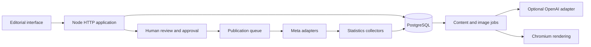

# Architecture guide

| Area | Entry points | Review focus |
| --- | --- | --- |
| Application | `server.js`, `worker.js` | HTTP routes, sessions, schema initialization and job lifecycle |
| Content creation | `content-studio/` | Brand configuration, structured outputs, review and rendering |
| Editorial processing | `community-editorial/` | Source reading, factual checks, manual input and state transitions |
| Visual jobs | `image-jobs/` | Idempotent queueing, recovery and authenticated media |
| Editorial approval | `studio-module/` | Versioned drafts, approvals and publication preconditions |
| Social connections | `social-connections/` | OAuth flow, access boundaries and encrypted credentials |
| Publishing | `social-publishing/`, `publisher/` | Leases, per-network delivery state and uncertain outcomes |
| Analytics | `social-statistics/`, `statistics/` | Metric collection and display |
| Legacy feed | `community-feed/` | Earlier isolated editorial feed implementation |
| Contracts/simulation | `contract.cjs`, `approval-model.cjs`, `build.cjs` | Offline validation and simulated publication plan |

The application contains both newer multi-client modules and older dedicated
modules. These coexist in the source snapshot; integration flags determine which
paths are active. The export does not claim to have unified or refactored them.

Publishing is asynchronous. A reviewed draft is associated with its revision and
source/media fingerprint. Workers track each network separately. An ambiguous
external outcome is treated as uncertain to avoid blind retries and duplicate posts.

